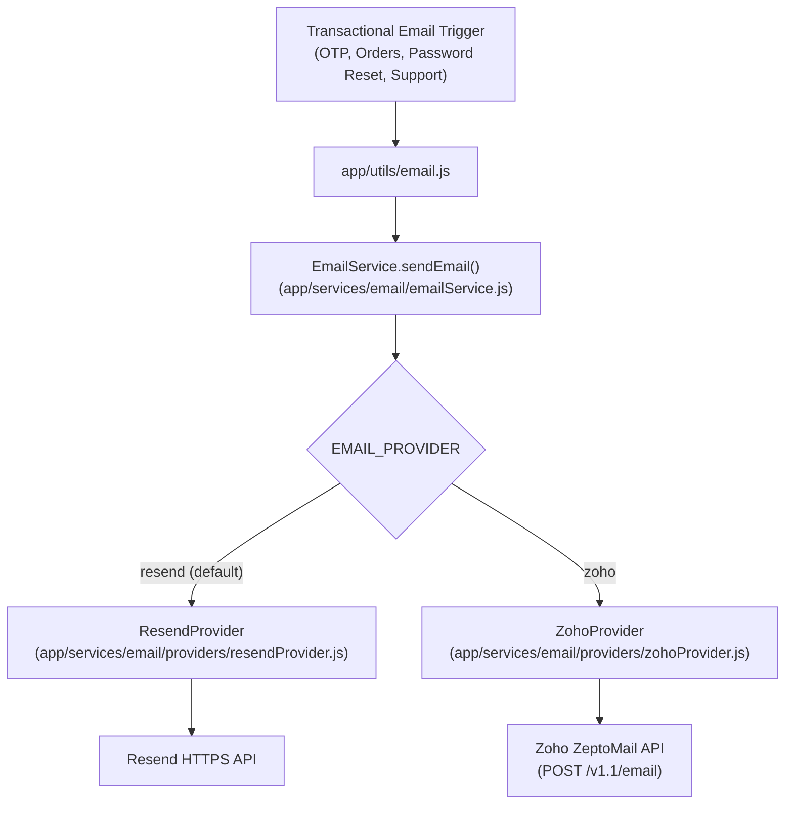

# BentoBabu — Transactional Email Provider Architecture (Resend & Zoho ZeptoMail)

This document describes the configurable, multi-provider email architecture for BentoBabu's backend.

---

## 1. Overview & Provider-Switching Architecture

BentoBabu supports two production-grade transactional email providers:
1. **Resend** (default) — using the official Resend SDK.
2. **Zoho ZeptoMail** — using the official Zoho ZeptoMail REST API (`https://cpaas.zoho.in/v1.1/email` for Zoho India accounts).

Provider selection is completely driven by the environment variable `EMAIL_PROVIDER`. Switching providers requires **zero code changes** and takes effect immediately upon application restart or container redeployment.



---

## 2. Environment Variables

### Provider Selection
| Variable | Allowed Values | Default | Description |
| :--- | :--- | :--- | :--- |
| `EMAIL_PROVIDER` | `resend`, `zoho` | `resend` | Active transactional email provider |

### Resend Configuration (used when `EMAIL_PROVIDER=resend`)
| Variable | Required | Default | Description |
| :--- | :--- | :--- | :--- |
| `RESEND_API_KEY` | Yes (when resend active & email OTP on) | None | Resend API key starting with `re_` |
| `RESEND_FROM_EMAIL` | Optional | `EMAIL_FROM` | Sender email address (e.g. `BentoBabu <verify@bentobabu.com>`) |
| `EMAIL_FROM` | Optional | `BentoBabu <verify@bentobabu.com>` | Global fallback sender address |

### Zoho ZeptoMail Configuration (used when `EMAIL_PROVIDER=zoho`)
| Variable | Required | Default | Description |
| :--- | :--- | :--- | :--- |
| `ZOHO_ZEPTOMAIL_API_KEY` | Yes (when zoho active & email OTP on) | None | ZeptoMail Send Mail Token (e.g. `Zoho-enczapikey phl...` or raw token) |
| `ZOHO_ZEPTOMAIL_FROM_EMAIL` | Yes (when zoho active) | `verify@bentobabu.com` | Verified sender email in ZeptoMail Mail Agent |
| `ZOHO_ZEPTOMAIL_FROM_NAME` | Optional | `BentoBabu` | Display name for the sender |
| `ZOHO_ZEPTOMAIL_API_URL` | Optional | `https://cpaas.zoho.in/v1.1/email` | Endpoint URL (defaults to Zoho India `https://cpaas.zoho.in/v1.1/email`) |

---

## 3. How to Configure Zoho ZeptoMail

1. **Sign Up / Log In** to [Zoho ZeptoMail Console](https://zeptomail.zoho.com).
2. **Configure Domain & DNS:**
   - Add your sending domain (e.g. `bentobabu.com`).
   - Verify SPF, DKIM, and CNAME records in your DNS provider (Cloudflare, GoDaddy, Route53).
3. **Create a Mail Agent:**
   - Navigate to **Mail Agents** &rarr; **Add Mail Agent**.
   - Name your mail agent (e.g., `bentobabu-production`).
4. **Generate Send Mail Token:**
   - Go to your Mail Agent &rarr; **Setup Info** &rarr; **Send Mail Token**.
   - Copy the generated token string.
5. **Configure Environment Variables in BentoBabu Backend:**
   ```env
   EMAIL_PROVIDER=zoho
   ZOHO_ZEPTOMAIL_API_KEY=phl087xxxxxx...
   ZOHO_ZEPTOMAIL_FROM_EMAIL=verify@bentobabu.com
   ZOHO_ZEPTOMAIL_FROM_NAME=BentoBabu
   ZOHO_ZEPTOMAIL_API_URL=https://cpaas.zoho.in/v1.1/email
   ```
   *(Note: You can paste either the token directly or prefixed with `Zoho-enczapikey `; the backend formats the header to `Zoho-enczapikey <YOUR_TOKEN>`.)*

---

## 4. How to Switch Between Providers

### To switch to Zoho ZeptoMail:
1. In your `.env` (or hosting dashboard like Render / Heroku / Railway):
   ```env
   EMAIL_PROVIDER=zoho
   ZOHO_ZEPTOMAIL_API_KEY=your_zeptomail_token
   ZOHO_ZEPTOMAIL_FROM_EMAIL=verify@bentobabu.com
   ZOHO_ZEPTOMAIL_FROM_NAME=BentoBabu
   ```
2. Restart the backend service.
3. During startup, verify the console log:
   ```text
   [Email] Transactional email provider initialized: zoho
   ```

### To switch back to Resend:
1. In your `.env`:
   ```env
   EMAIL_PROVIDER=resend
   RESEND_API_KEY=re_your_resend_key
   ```
2. Restart the backend service.
3. Verify the console log:
   ```text
   [Email] Transactional email provider initialized: resend
   ```

---

## 5. Security & Reliability Highlights

- **Credentials Isolation:** Inactive provider credentials are never validated or initialized. If you use Resend, Zoho credentials are not required; if you use Zoho, Resend credentials are not required.
- **Fail-Fast Configuration Validation:** Invalid `EMAIL_PROVIDER` values (e.g. `sendgrid`) or missing credentials for the *selected* provider abort application startup with clear, actionable error messages.
- **Zero API Key Leakage:** API keys and sensitive message bodies are never written to logs. Only masked recipient addresses (e.g. `a***a@example.com`) and message IDs are logged.
- **Strict Provider Isolation:** When a provider fails, the system does not silently switch providers or send duplicate emails. Standard error handling and retry queues (`NotificationDispatcher`) manage delivery safely.
- **Backward Compatibility:** All existing controllers (`authController`, `deliveryOnboardingController`, `notificationDispatcher`), email templates, and automated tests remain 100% functional without modification.
